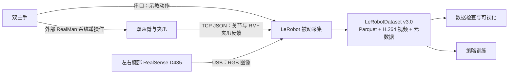

# LeRobot × RealMan 双臂

<p align="center">
  <strong>面向 ALOHA 风格 RealMan 双臂平台的数据采集与机器人学习适配</strong><br>
  双主手示教 · 双从臂反馈 · 双腕部视觉 · LeRobot 数据集
</p>

<p align="center">
  <a href="pyproject.toml"></a>
  <a href="pyproject.toml"></a>
  <a href="docs/realman_usage.md#6-数据格式"></a>
  <a href="LICENSE"></a>
</p>

<p align="center">
  <a href="#快速开始">快速开始</a> ·
  <a href="#数据格式">数据格式</a> ·
  <a href="#策略训练">策略训练</a> ·
  <a href="docs/realman_usage.md">操作手册</a> ·
  <a href="#文档">文档导航</a>
</p>

## 项目介绍

本项目基于 [Hugging Face LeRobot](https://github.com/huggingface/lerobot)，为 ALOHA 风格的 **RealMan 双主手、双从臂、双腕部相机**平台提供硬件适配与采集流程。面向需要建立双臂示教数据集、检查真实硬件反馈，并进一步开展模仿学习的使用者。

当前默认采用**被动采集模式**：外部 RealMan 系统负责主从遥操作，LeRobot 按目标频率读取主手动作、从臂状态与相机图像，保存为标准 LeRobot 数据集。采集程序不向机械臂或夹爪发送动作指令。

本页对应 `dev` 分支，源码包版本为 `0.5.2`，是本项目的定制快照。包版本与 Dataset v3.0 是不同概念；具体采集接口和配置以当前分支为准。

## 主要功能

| 能力 | 本项目提供的内容 |
| --- | --- |
| 双臂硬件适配 | RealMan TCP JSON 从臂反馈、RM ALOHA 串口主手、单臂与双臂封装 |
| RM_ARM+ 夹爪反馈 | 读取 CTAG2F120 实际位置，检查无效反馈，保留合法的闭合零值 |
| 双视角 RGB 采集 | 左右腕部 RealSense D435，模板配置为 `640×480 / 30 FPS`，不启用深度与顶部相机 |
| 统一数据保存 | 14 维 `action`、14 维 `observation.state`、两路腕部视频及任务信息 |
| 日常硬件检查 | 一条命令汇总两侧从臂、夹爪、主手与相机共 8 项结果，按需导出 JSON |
| 离线回归与审计 | 模拟传输检查反馈解析、动作字段、被动录制与数据落盘，无需连接实机 |

## 分支与版本

| 分支 | 源码版本 / 用途 | 使用建议 |
| --- | --- | --- |
| [`dev`](https://github.com/JIA-Z423/lerobot-realman/tree/dev)（本页） | LeRobot `0.5.2` 定制快照 | 复现既有 RealMan 反馈验证与采集流程 |
| [`upgrade/lerobot-v0.7.0`](https://github.com/JIA-Z423/lerobot-realman/tree/upgrade/lerobot-v0.7.0) | LeRobot `0.7.0` 升级适配 | 使用新版接口开展开发；按该分支文档准备独立环境并完成实机验收 |
| [`main`](https://github.com/JIA-Z423/lerobot-realman/tree/main) | 项目早期说明 | 查阅历史项目背景；操作步骤以所用分支的文档为准 |

两分支的编码配置不同：本分支使用 `dataset.vcodec`，`0.7.0` 分支使用 `dataset.rgb_encoder.vcodec`。切换分支时同步相应依赖并核对配置，避免直接复用另一分支的环境或本地配置。

## 硬件与数据链路



| 设备 | 连接与配置 | 采集内容 |
| --- | --- | --- |
| 左、右 RealMan 从臂 | TCP JSON，默认端口 `8080` | 每侧 6 个关节位置 |
| 左、右 CTAG2F120 夹爪 | 通过从臂 RM_ARM+ 反馈接口读取 | 每侧 1 个归一化位置 |
| 左、右 RM ALOHA 主手 | 串口，`460800 baud` | 每侧 6 个关节及 1 个夹爪位置 |
| 左、右腕部 D435 | USB，按设备序列号匹配 | 两路 `640 × 480` RGB 图像 |

采集频率由 `dataset.fps` 控制，模板目标为 `30 FPS`。数据集时间戳与取到的最新图像不等于传感器硬件同步；实际频率需要在目标电脑上测量。

## 当前状态

| 能力 | 已有结果与边界 |
| --- | --- |
| 从臂与 RM+ 夹爪反馈 | 已实机验证位置读取及从原始回包到 Parquet 的一致性；全量程精度、毫米标定尚未验收 |
| 数值采集与落盘 | 历史诊断录制为 360 帧，`state/action` 均为 `[360, 14]`，平均约 `29.81 Hz`；该次测试不含相机，也不属于正式训练示教 |
| 双腕部相机 | 已验证两台设备识别及同时取帧；双路视频写入、编码与持续 30 FPS 的整机性能待验收 |
| 策略训练 | 保留上游实现，RealMan 任务的训练效果待验证 |
| RealMan 策略部署 | 仍需控制适配与实机验收；当前 RM+ 通用动作接口拒绝发送动作 |

以上实机证据来自既有记录，详见[夹爪修复与实机验证记录](docs/realman_data_collection_check.md)。重新上电或连接设备后，请重新执行只读检查。

## 快速开始

首次使用请按[操作手册](docs/realman_usage.md)准备 Conda 环境与本地硬件配置，然后在仓库根目录运行：

```bash
conda activate lerobot

# 检查硬件读取
python examples/realman/check_realman_readonly.py --summary

# 开始被动示教采集
lerobot-record \
  --config_path=configs/hardware/realman_double_arm_hardware_config.local.yaml \
  --play_sounds=false
```

环境安装、配置字段、录制控制、续录与排障见[完整使用手册](docs/realman_usage.md)。

## 数据格式

| 字段 | 形状 / 内容 | 来源 |
| --- | --- | --- |
| `action` | 14 维示教动作 | 双主手测量值 |
| `observation.state` | 14 维实际状态 | 双从臂关节与 RM+ 夹爪反馈 |
| `observation.images.left_wrist` | 左腕 RGB 图像 / 视频 | 左腕相机 |
| `observation.images.right_wrist` | 右腕 RGB 图像 / 视频 | 右腕相机 |

`action` 和 `observation.state` 的排列均为：**左侧 6 关节 → 左夹爪 → 右侧 6 关节 → 右夹爪**。夹爪索引为 `6`、`13`，从 0 开始。两者分别来自主手与从臂，不能互相填补；主从物理映射和比例需在正式示教前核对。

当前从臂 RM+ 夹爪位置来自 `state_info.pos[0] / 1000`，归一化值无量纲，闭合时为 `0` 可以正常；它不是毫米。反馈缺失或设备错误应处理为采集异常。

```text
datasets/realman_double_arm_dataset/
├── data/       # Parquet：动作、状态、索引与时间戳
├── meta/       # 数据集信息、统计与 episode 元数据
└── videos/     # 左右腕部 RGB 视频
```

视频具体路径以 `meta/info.json` 为准。数据集格式说明见[LeRobotDataset v3.0](docs/source/lerobot-dataset-v3.mdx)。历史夹爪恒零数据和异常主手数据需要单独审查，修复代码不会自动修正旧 episode。

## 数据查看

后续查看与训练命令沿用模板的 `repo_id` 和 `root`；如果已修改本地配置，请同步替换示例中的值。

采集后先查看元数据，再检查动作、状态曲线和两路视频：

```bash
lerobot-edit-dataset \
  --repo_id local/realman_double_arm_dataset \
  --root datasets/realman_double_arm_dataset \
  --operation.type=info

lerobot-dataset-viz \
  --repo-id local/realman_double_arm_dataset \
  --root datasets/realman_double_arm_dataset \
  --episode-index 0
```

无图形界面的机器可在可视化命令中追加 `--save 1 --output-dir visualizations`，导出 `.rrd` 文件后在桌面端 Rerun 打开。左右画面、时间轴、夹爪变化与主从动作都应符合实际示教；更多方法见[数据可视化手册](docs/realman_usage.md#7-数据可视化)。

## 策略训练

采集的数据可用于 ACT、Diffusion、SmolVLA 等上游策略。依赖安装和本地数据集训练示例见[操作手册](docs/realman_usage.md#9-策略训练)，模型介绍见 [ACT](docs/source/policy_act_README.md)、[Diffusion](docs/source/policy_diffusion_README.md) 和 [SmolVLA](docs/source/policy_smolvla_README.md)。

RealMan 任务的训练效果与闭环部署尚未验收；当前 RM+ 适配仍拒绝发送动作。

## 文档

| 文档 | 适合解决的问题 |
| --- | --- |
| [RealMan 操作与硬件检查手册](docs/realman_usage.md) | 环境、配置、检查、采集、续录、可视化与训练的完整步骤 |
| [夹爪修复与实机验证记录](docs/realman_data_collection_check.md) | 为什么原生夹爪接口恒零、RM+ 反馈链路如何验证、还有哪些限制 |
| [公开硬件配置模板](configs/hardware/realman_double_arm_hardware_config.yaml) | 查阅设备与采集参数，建立个人本地配置 |
| [离线采集管道检查](examples/realman/audit_offline_pipeline.py) | 在模拟传输下检查适配与落盘流程 |
| [数据集工具](docs/source/using_dataset_tools.mdx) | 查看、拆分、合并与编辑 LeRobot 数据集 |
| [上游文档源码](docs/source/) | 数据集、策略、训练与硬件接口教程 |
| [上游 README 快照](UPSTREAM_LEROBOT_README.md) | 查阅 LeRobot 原始项目介绍与生态入口 |
| [文档目录与构建说明](docs/README.md) | 查找本项目文档，构建上游文档站 |

## 项目结构

```text
.
├── configs/hardware/                   # 公开模板与本地硬件配置
├── examples/realman/                   # 只读检查、夹爪监视与离线验证
├── src/lerobot/
│   ├── robots/realman_follower/         # 单 RealMan 从臂适配
│   ├── robots/double_realman_follower/  # 双从臂组合
│   ├── teleoperators/rm_aloha_master/   # 单主手协议与解码
│   ├── teleoperators/double_rm_aloha_master/ # 双主手组合
│   ├── datasets/                       # 数据集与视频读写
│   ├── policies/                       # 上游策略实现
│   └── scripts/                        # 采集、训练、评估与可视化入口
├── tests/common/test_realman_*.py       # RealMan 回归测试
├── docs/                               # 操作手册、验证记录与上游文档
├── datasets/                           # 本地数据，不提交 Git
├── outputs/                            # 训练和运行输出，不提交 Git
└── visualizations/                     # Rerun 导出，不提交 Git
```

厂家参考项目 `rm_aloha_v1` 位于本机仓库同级目录，不随本仓库分发；当前默认 `socket_json` 被动采集流程不要求把它复制进仓库。

## 常见问题

| 现象 | 检查方向 |
| --- | --- |
| `ModuleNotFoundError` 或环境中找不到 RealMan 适配 | 确认当前分支、已安装所需扩展，并从仓库根目录设置 `PYTHONPATH` |
| 主手端口不存在、重插后左右变化 | 查看 `/dev/serial/by-id/`，按物理身份填写稳定路径，并核对权限、占用与波特率 |
| RealSense 无法枚举 | 先区分依赖导入失败与 USB 未识别，再检查供电、线束、Hub、权限和进程占用 |
| 相机已枚举但无法匹配配置 | 核对本地序列号和物理左右；仅修改序列号无法修复 USB 未枚举 |
| 夹爪位置为零 | 闭合时可能正常；肉眼张开却仍为零时检查 RM+ 身份、状态和连续反馈，勿改回原生反馈或关闭夹爪字段 |
| 数据目录已存在 | 新任务换用新目录；向同一数据集追加时核对 schema 后使用 `--resume=true` |
| 目标 30 FPS 但实际频率不足 | 检查采集耗时和两路视频写入、编码性能；目标帧率不代表每个周期达标 |

在线文档可能随上游变化；本仓库的配置和行为以当前分支源码及本地手册为准。具体命令和判据见[硬件检查](docs/realman_usage.md#4-手动硬件检查)与[已知限制](docs/realman_data_collection_check.md#5-已知限制与历史数据)。

## 后续工作

- 核对主手物理左右、关节方向与主从标尺，建立正式示教的数据质量检查流程。
- 完成带双路视频写入与编码的持续采集性能验收。
- 验证 RealMan 示教数据上的策略训练效果与评估流程。
- 完成 RM+ 动作控制适配与闭环部署验收。

## 贡献与许可

欢迎通过 [Issue](https://github.com/JIA-Z423/lerobot-realman/issues) 或 Pull Request 改进硬件适配、补充可复现验证或完善文档。提交问题时请附上分支、包版本、复现步骤和必要的检查结果；共享前移除报告中的真实地址、设备序列号与本地路径。贡献代码前请阅读[贡献指南](CONTRIBUTING.md)。

本项目基于 [Hugging Face LeRobot](https://github.com/huggingface/lerobot)，感谢上游提供机器人接口、数据集、策略训练与可视化工具，也感谢 RealMan 厂家配套项目提供通信和遥操作参考。代码沿用 [Apache License 2.0](LICENSE)。
