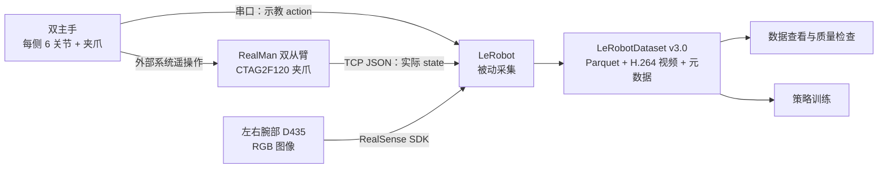

# LeRobot × RealMan 双臂

<p align="center">
  <strong>面向 ALOHA 风格 RealMan 双臂平台的数据采集与机器人学习适配</strong><br>
  双主手示教 · 双从臂反馈 · 双腕部视觉 · LeRobot 数据集
</p>

<p align="center">
  <a href="pyproject.toml"></a>
  <a href="pyproject.toml"></a>
  <a href="docs/realman_usage.md#6-数据格式"></a>
  <a href="LICENSE"></a>
</p>

<p align="center">
  <a href="#快速开始">快速开始</a> ·
  <a href="#数据格式">数据格式</a> ·
  <a href="#策略训练">策略训练</a> ·
  <a href="docs/realman_usage.md">操作手册</a> ·
  <a href="#文档">文档导航</a>
</p>

## 项目介绍

本项目基于 [Hugging Face LeRobot](https://github.com/huggingface/lerobot)，为 RealMan 双臂平台提供硬件适配、只读检查和被动示教采集流程。它将双主手动作、双从臂与夹爪反馈、左右腕部 RGB 图像写入统一的 LeRobot 数据集，为后续模仿学习训练准备数据。

当前工作重点是**可靠地采集和检查真实硬件数据**。默认采用被动采集：厂家或外部 RealMan 系统负责主从遥操作，LeRobot 读取并保存数据。仓库同时保留上游策略与训练工具，RealMan 任务的训练效果和闭环部署仍需验证。

## 主要功能

| 能力 | 本项目提供的内容 |
| --- | --- |
| 双臂硬件适配 | RealMan TCP JSON 从臂反馈、RM ALOHA 串口主手、单臂与双臂封装 |
| RM_ARM+ 夹爪反馈 | 读取 CTAG2F120 实际位置，检查无效反馈，保留合法的闭合零值 |
| 双视角 RGB 采集 | 左右腕部 RealSense D435，模板配置为 `640×480 / 30 FPS`，不启用深度与顶部相机 |
| 统一数据保存 | 14 维 `action`、14 维 `observation.state`、两路腕部视频及任务信息 |
| 日常硬件检查 | 一条命令汇总两侧从臂、夹爪、主手与相机共 8 项结果，按需导出 JSON |
| 离线回归与审计 | 模拟传输检查反馈解析、动作字段、被动录制与数据落盘，无需连接实机 |

## 分支与版本

**当前 README 对应 `upgrade/lerobot-v0.7.0`。** 两个分支分别准备环境和本地配置，切换源码时也应切换对应环境。

| 分支 | LeRobot 版本 | 用途与区别 |
| --- | --- | --- |
| [`upgrade/lerobot-v0.7.0`](https://github.com/JIA-Z423/lerobot-realman/tree/upgrade/lerobot-v0.7.0) | `0.7.0` | 新版迁移与验收；编码字段为 `dataset.rgb_encoder.vcodec`，策略执行入口为 `lerobot-rollout` |
| [`dev`](https://github.com/JIA-Z423/lerobot-realman/tree/dev) | `0.5.2` | 原有开发与实机采集基线；安装、编码字段和训练参数以该分支文档为准 |
| [`main`](https://github.com/JIA-Z423/lerobot-realman/tree/main) | 以分支源码为准 | 项目早期说明与历史参考；当前采集流程见对应开发分支 |

从 `dev` 迁移时，将旧的 `dataset.vcodec` 改为 `dataset.rgb_encoder.vcodec`，并设置 `dataset.no_stamp: true` 以保持固定的数据集标识。新版训练跟踪使用 `trackio`；配置迁移方法见[操作手册](docs/realman_usage.md#3-配置文件)。LeRobot 包版本 `0.7.0` 与数据集格式 `v3.0` 是不同的版本标识。

## 硬件与数据链路



主手串口、从臂 TCP 网络和相机 USB 是独立的数据通路。LeRobot 按 `dataset.fps` 采样；数据集时间戳和相机最新帧不代表传感器已经硬件同步。当前配置的机械臂型号参数为 `arm_model: 65`，主手波特率为 `460800`，从臂 TCP 端口为 `8080`；连接前仍需核对自己的设备。

## 快速开始

首次使用请按[操作手册](docs/realman_usage.md)准备 Conda 环境与本地硬件配置，然后在仓库根目录运行：

```bash
conda activate lerobot070

# 检查硬件读取
python examples/realman/check_realman_readonly.py --summary

# 开始被动示教采集
lerobot-record \
  --config_path=configs/hardware/realman_double_arm_hardware_config.local.yaml \
  --play_sounds=false
```

环境安装、配置字段、录制控制、续录与排障见[完整使用手册](docs/realman_usage.md)。

## 数据格式

| 字段 | 默认内容 | 数据来源 |
| --- | --- | --- |
| `action` | 14 维数值 | 双主手测量，作为示教动作 |
| `observation.state` | 14 维数值 | 双从臂关节与实际夹爪反馈 |
| `observation.images.left_wrist` | `640×480` RGB 视频 | 左腕 D435 |
| `observation.images.right_wrist` | `640×480` RGB 视频 | 右腕 D435 |

两个数值向量均采用以下顺序，索引从 0 开始：

```text
[左关节1 … 左关节6, 左夹爪, 右关节1 … 右关节6, 右夹爪]
        0 … 5         6         7 … 12        13
```

RM+ 夹爪读取 `get_rm_plus_state_info.state_info.pos[0] / 1000`，归一化范围为 `0..1`，它不是毫米。闭合时 `0` 可以正常；缺失、离线或无效反馈会报错，不能用补零代替。主手与从臂使用各自配置的比例，正式示教前需核对物理左右、方向和标尺；`action` 不能替代实际从臂状态。

```text
datasets/realman_double_arm_dataset/
├── data/       # Parquet：动作、状态、帧索引等
├── meta/       # 数据集信息、任务、统计和 episode 元数据
└── videos/     # 左右腕部视频
```

具体特征名、形状、FPS 和文件路径以本次数据集的 `meta/info.json` 为准。字段含义见[数据格式手册](docs/realman_usage.md#6-数据格式)，格式设计见[LeRobotDataset v3.0](docs/source/lerobot-dataset-v3.mdx)。

## 数据查看

后续查看与训练命令沿用模板的 `repo_id` 和 `root`；如果已修改本地配置，请同步替换示例中的值。

采集后使用 Rerun 同时查看两路视频、动作、状态和时间轴：

```bash
python -m lerobot.scripts.lerobot_dataset_viz \
  --display-mode=rerun \
  --repo-id local/realman_double_arm_dataset \
  --root datasets/realman_double_arm_dataset \
  --episode-index 0
```

无图形界面时，可追加 `--save 1 --output-dir visualizations` 导出 `.rrd`，再到有界面的机器查看，完整命令见[数据可视化手册](docs/realman_usage.md#7-数据可视化)。重点确认两路画面、时间连续性，以及 `observation.state` 索引 `6`、`13` 是否反映实际夹爪开合。

历史诊断数据、夹爪恒零问题期间的数据与新的任务示教数据应分目录保留，确认质量后再用于训练。

## 策略训练

采集的数据可用于 ACT、Diffusion、SmolVLA 等上游策略。依赖安装和本地数据集训练示例见[操作手册](docs/realman_usage.md#9-策略训练)。

| 方向 | 文档入口 |
| --- | --- |
| ACT / Diffusion | [ACT](docs/source/policy_act_README.md) · [Diffusion](docs/source/policy_diffusion_README.md) |
| 视觉语言动作策略 | [SmolVLA](docs/source/smolvla.mdx) · [π0](docs/source/pi0.mdx) · [π0.5](docs/source/pi05.mdx) |
| 训练资源与自定义策略 | [硬件资源指南](docs/source/hardware_guide.mdx) · [接入自己的策略](docs/source/bring_your_own_policies.mdx) |
| 策略执行接口 | [部署说明](docs/source/inference.mdx)；0.7.0 使用 `lerobot-rollout` |

`lerobot-record` 需要主手输入，不接受旧版 `--policy.*` 参数。当前 RM+ 后端仍拒绝发送动作，RealMan 策略执行需先完成控制适配和实机验收。

## 文档

| 想了解的内容 | 推荐入口 |
| --- | --- |
| 安装、配置、采集、续录、数据查看与训练 | [RealMan 双臂操作与硬件检查手册](docs/realman_usage.md) |
| 夹爪恒零原因、修复和实机验证范围 | [夹爪修复与验证记录](docs/realman_data_collection_check.md) |
| 全部项目文档及文档站维护 | [文档目录](docs/README.md) |
| 只读检查、连续监视与离线审计 | [检查器](examples/realman/check_realman_readonly.py) · [夹爪监视器](examples/realman/watch_realman_gripper.py) · [离线采集审计](examples/realman/audit_offline_pipeline.py) |
| 数据集编辑与管理 | [数据集工具](docs/source/using_dataset_tools.mdx) |
| 上游能力与接口 | [本分支上游 README 快照](UPSTREAM_LEROBOT_README.md) · [文档源码](docs/source/) · [LeRobot 在线文档](https://huggingface.co/docs/lerobot) |

在线文档可能随上游变化；本仓库的配置和行为以当前分支源码及本地手册为准。

## 项目结构

```text
configs/hardware/                         # 公开配置模板；*.local.yaml 保存本地参数
examples/realman/                         # 只读检查、夹爪监视、离线采集审计
src/lerobot/
├── robots/realman_follower/               # 单从臂适配
├── robots/double_realman_follower/        # 双从臂组合
├── teleoperators/rm_aloha_master/         # 单主手串口适配
├── teleoperators/double_rm_aloha_master/  # 双主手组合
├── datasets/                            # 数据集读写与视频工具
├── policies/                            # 上游策略实现
└── scripts/                             # 采集、训练、可视化等 CLI 入口
tests/common/test_realman_*.py            # RealMan 离线回归
docs/                                    # 操作手册、验证记录与上游文档
datasets/                                # 本地数据（不提交）
outputs/                                 # 训练与运行输出（不提交）
visualizations/                          # 可视化导出（不提交）
```

## 常见问题

| 问题 | 排查入口 |
| --- | --- |
| 切换分支后配置报未知字段 | 核对 LeRobot 版本、源码路径与环境；新版使用 `dataset.rgb_encoder.vcodec`，迁移说明见[配置文件](docs/realman_usage.md#3-配置文件) |
| 夹爪值为 0，是否故障？ | 全程闭合可以为 0；实际张开仍恒零时，检查 RM+ 反馈与设备在线状态，见[夹爪检查](docs/realman_usage.md#42-夹爪确认读取了正确反馈正确理解-0) |
| 主手串口消失或左右变化 | 核对 `/dev/serial/by-id/`、权限、占用和 `460800` 波特率，见[串口与网络](docs/realman_usage.md#44-主手串口和从臂网络) |
| 相机未识别、序列号不匹配或取帧失败 | 分别检查 SDK 枚举、YAML 序列号、供电、USB 带宽和设备占用，见[相机检查](docs/realman_usage.md#43-腕部相机区分未识别序列号不匹配和取帧失败) |
| 设置 30 FPS 就能稳定采集吗？ | 这是目标频率；应测量双路视频写入和编码时的实际性能，单帧取图通过不能代替持续录制验收 |
| 检查参数为什么有两种拼法？ | 采集使用 `--config_path`；检查器、夹爪监视器使用 `--config-path`；可视化使用 `--repo-id` |

## 后续工作

- 完成 0.7.0 干净环境与实机采集验收，测量双路视频持续录制性能。
- 核对主从左右映射、关节方向、量纲及夹爪动态反馈，建立任务数据质量检查流程。
- 验证 RealMan 任务的 ACT 等策略训练效果。
- 完善 RM+ 动作发送适配，完成实机策略执行验收。

## 贡献与许可

欢迎通过 [Issue](https://github.com/JIA-Z423/lerobot-realman/issues) 或 Pull Request 改进硬件适配、反馈解析、文档与测试。反馈问题时请注明分支、版本、复现步骤和脱敏日志；本地设备配置、诊断报告中的真实参数和采集数据不随提交上传。

开发规范见[贡献指南](CONTRIBUTING.md)。修改 RealMan 适配后，可使用[离线采集审计](examples/realman/audit_offline_pipeline.py)检查模拟传输与落盘流程。

本项目基于 [Hugging Face LeRobot](https://github.com/huggingface/lerobot)，感谢上游提供的数据集、硬件接口、策略与训练工具。
代码沿用 [Apache License 2.0](LICENSE)。上游引用信息见 [LeRobot README](UPSTREAM_LEROBOT_README.md#citation)。
