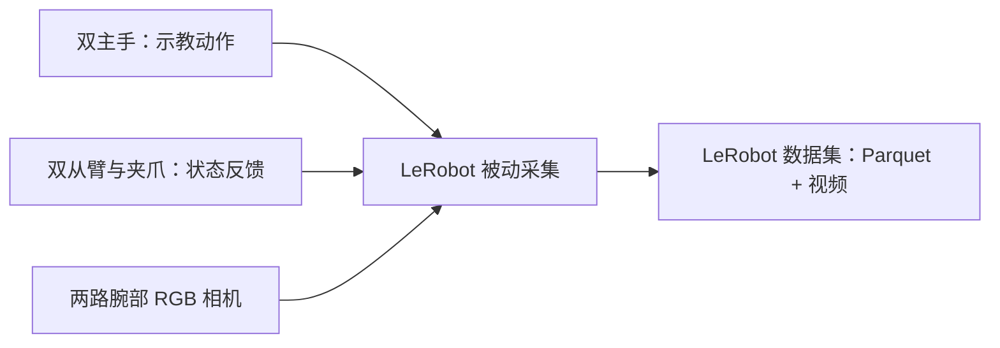

# LeRobot × RealMan 双臂

本页适用于 `upgrade/lerobot-v0.7.0` 分支，源码版本为 LeRobot `0.7.0`。请使用本分支的独立环境和配置；从 `dev` 的 `0.5.2` 环境迁移时，先按[操作手册](docs/realman_usage.md#1-环境安装)准备环境，再核对[配置差异](docs/realman_usage.md#3-配置文件)。

基于 [Hugging Face LeRobot](https://github.com/huggingface/lerobot) 的 RealMan 双臂数据采集适配，面向 ALOHA 风格的双主手、双从臂和腕部相机平台。

项目将 RealMan 的硬件反馈接入 LeRobot 数据集接口，记录示教动作、从臂状态和两路 RGB 视频，为后续模仿学习训练提供数据。当前默认使用**被动采集模式**：外部 RealMan 系统负责主从遥操作，LeRobot 负责读取与保存。

[快速开始](#快速开始) · [操作与检查手册](docs/realman_usage.md) · [修复与验证记录](docs/realman_data_collection_check.md) · [文档目录](docs/README.md)

## 主要功能

- **双臂硬件接入**：支持 RealMan TCP JSON 状态读取与双主手串口数据读取。
- **RM_ARM+ 夹爪反馈**：读取 CTAG2F120 的实际位置，检查异常反馈，保留合法的闭合零值。
- **腕部视觉采集**：支持两路 RealSense RGB 相机，当前配置为 `640×480、30 FPS`，未启用顶部相机。
- **LeRobot 数据集**：保存 14 维 `action`、14 维 `observation.state` 和两路腕部视频，可使用数据集工具查看。
- **手动简洁检查**：一条命令显示两侧从臂、夹爪、主手和相机共 8 项读取结果，可按需保存详细 JSON。



## 当前状态

| 能力 | 状态 |
| --- | --- |
| 双主手、双从臂与夹爪采集适配 | 已迁移到 0.7.0，离线录制与落盘审计通过；升级前的实机反馈验证见历史记录 |
| 两路腕部 D435 | 升级前已验证识别及同时取帧；0.7.0 下实机采集、双路编码与持续 30 FPS 待验收 |
| 策略训练 | 提供上游 ACT、Diffusion、SmolVLA、π 系列等实现；需另装训练及所选策略依赖，RealMan 训练效果待验证 |
| RealMan 策略部署 | 0.7.0 入口为 `lerobot-rollout`；当前 RM+ 适配仍拒绝发送动作，控制适配与实机验收待完成 |

`action` 来自主手测量，`observation.state` 来自从臂反馈，两者各为左右六关节加夹爪。详细数据含义与验收范围见[操作手册](docs/realman_usage.md)。

## 快速开始

以下命令在本分支的项目根目录执行。安装命令创建或同步本目录的 `.venv`；后续命令使用已激活的该环境。FFmpeg 与 PyTorch/CUDA 的准备见[环境说明](docs/realman_usage.md#1-环境安装)。

### 1. 准备环境与配置

```bash
uv sync --locked --extra core_scripts --extra intelrealsense
source .venv/bin/activate
export PYTHONPATH="$PWD/src${PYTHONPATH:+:$PYTHONPATH}"
```

根据[配置模板](configs/hardware/realman_double_arm_hardware_config.yaml)准备 `configs/hardware/realman_double_arm_hardware_config.local.yaml`，填写真实设备参数和任务信息。旧配置的 `dataset.vcodec` 需迁移为 `dataset.rgb_encoder.vcodec`；保持 `dataset.no_stamp: true` 以使用固定数据集标识。本地配置不提交 Git。

### 2. 手动检查硬件

```bash
python examples/realman/check_realman_readonly.py --summary
```

终端直接显示每项通过或失败的原因。完整检查应为 **8 项通过、失败 0、跳过 0**；检查只读取数据，不驱动设备。异常处理和分项检查见[硬件检查手册](docs/realman_usage.md#4-手动硬件检查)。

### 3. 开始被动采集

```bash
python -m lerobot.scripts.lerobot_record \
  --config_path=configs/hardware/realman_double_arm_hardware_config.local.yaml \
  --dataset.no_stamp=true \
  --play_sounds=false
```

本地配置保持 `passive_recording: true`，两侧的 `initialize_gripper_route`、`initialize_gripper_modbus` 和 `enable_calibration` 均为 `false`。`lerobot-record` 需要主手提供动作，仅用于示教采集；策略推理使用 `lerobot-rollout`。续录、数据格式及可视化见[操作手册](docs/realman_usage.md#5-数据采集)。

## 文档

| 文档 | 内容 |
| --- | --- |
| [操作与硬件检查手册](docs/realman_usage.md) | 环境、本地配置、手动检查、异常排查、采集、续录和数据查看 |
| [夹爪修复与实机验证记录](docs/realman_data_collection_check.md) | 恒零原因、修复链路、设备信息、验证证据与限制 |
| [0.7.0 升级评估与离线验证](docs/lerobot_upstream_upgrade_2026-11-10.md) | 版本与接口变化、迁移内容、历史测试证据及复现方法 |
| [上游文档源码](docs/source/) | 策略、数据集、训练与硬件接口的 LeRobot 文档 |
| [贡献指南](CONTRIBUTING.md) | 上游开发与贡献规范 |

## 项目结构

```text
configs/hardware/     双臂配置模板与本地设备配置
examples/realman/     只读检查、夹爪监视及离线验证工具
src/lerobot/          LeRobot 主体与 RealMan 机器人、主手适配
docs/                操作手册、验证记录和上游文档
datasets/            本地采集数据（不提交）
outputs/             训练与运行输出（不提交）
```

## 致谢与许可

本项目基于 [Hugging Face LeRobot](https://github.com/huggingface/lerobot)，感谢上游提供机器人接口、数据集、策略训练和可视化工具。RealMan 通信与主从遥操作适配参考了厂家配套项目。

代码沿用 [Apache License 2.0](LICENSE)。
