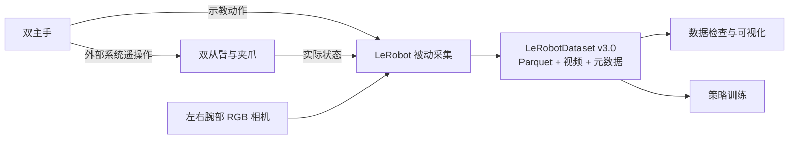

# LeRobot × RealMan 双臂

<p align="center">
  <strong>RealMan 双臂示教采集与机器人学习适配</strong><br>
  双主手示教 · 双从臂反馈 · 双腕部视觉 · LeRobot 数据集
</p>

<p align="center">
  <a href="pyproject.toml"></a>
  <a href="pyproject.toml"></a>
  <a href="docs/realman_usage.md#6-数据格式"></a>
  <a href="LICENSE"></a>
</p>

<p align="center">
  <a href="#快速开始">快速开始</a> ·
  <a href="#数据格式">数据格式</a> ·
  <a href="docs/realman_usage.md">操作手册</a> ·
  <a href="#文档">文档导航</a>
</p>

## 项目介绍

本项目基于 [Hugging Face LeRobot](https://github.com/huggingface/lerobot)，为 ALOHA 风格的 RealMan 双主手、双从臂和腕部相机平台提供硬件适配与示教采集工具，将动作、实际状态和 RGB 视频保存为 LeRobot 数据集，用于后续模仿学习。

默认采用**被动采集模式**：外部 RealMan 系统负责主从遥操作，LeRobot 读取并保存数据。

## 主要功能

- **双臂接入**：通过 TCP JSON 读取从臂反馈，通过串口读取双主手动作。
- **夹爪反馈**：支持 CTAG2F120 的 RM_ARM+ 位置读取，检查异常反馈并保留合法零值。
- **双腕部视觉**：支持两台 RealSense D435，模板配置为 `640×480 / 30 FPS` RGB。
- **标准数据集**：保存 14 维动作、14 维状态和两路视频，支持续录与 Rerun 可视化。
- **检查与审计**：提供 8 项硬件读取摘要、夹爪连续监视和离线采集审计工具。

## 数据链路



采集频率由 `dataset.fps` 决定；数据集时间戳不代表传感器硬件同步。

## 快速开始

先按[操作手册](docs/realman_usage.md)准备 Conda 环境和本地硬件配置，再在项目根目录运行：

```bash
conda activate lerobot

# 检查硬件读取
python examples/realman/check_realman_readonly.py --summary

# 开始被动示教采集
lerobot-record \
  --config_path=configs/hardware/realman_double_arm_hardware_config.local.yaml \
  --play_sounds=false
```

安装、配置、录制控制、续录和排障步骤见[完整使用手册](docs/realman_usage.md)。

## 数据格式

| 字段 | 内容 |
| --- | --- |
| `action` | 14 维双主手示教动作 |
| `observation.state` | 14 维双从臂关节与夹爪实际反馈 |
| `observation.images.left_wrist` | 左腕 RGB 视频 |
| `observation.images.right_wrist` | 右腕 RGB 视频 |

数值顺序为左侧 6 关节、左夹爪、右侧 6 关节、右夹爪，夹爪索引为 `6`、`13`（从 0 开始）。RM+ 夹爪位置归一化为 `0..1`，闭合时 `0` 可以正常；主手与从臂的物理映射和标尺需在示教前核对。

当前以被动采集为主，RM+ 适配仅支持读取。双路视频持续 30 FPS、RealMan 任务训练效果和实机闭环仍需验收，详细验证范围见[验证记录](docs/realman_data_collection_check.md)。

## 文档

| 内容 | 入口 |
| --- | --- |
| 安装、配置、硬件检查与采集 | [RealMan 操作手册](docs/realman_usage.md) |
| 数据查看与导出 | [数据可视化](docs/realman_usage.md#7-数据可视化) |
| 策略依赖与 ACT 训练示例 | [策略训练](docs/realman_usage.md#9-策略训练) |
| 夹爪反馈、修复与验证范围 | [实机验证记录](docs/realman_data_collection_check.md) |
| 数据集编辑与管理 | [数据集工具](docs/source/using_dataset_tools.mdx) |
| 更多教程与接口 | [文档目录](docs/README.md) · [上游文档源码](docs/source/) |

## 贡献与许可

欢迎通过 [Issue](https://github.com/JIA-Z423/lerobot-realman/issues) 或 Pull Request 改进代码和文档，开发规范见[贡献指南](CONTRIBUTING.md)。提交前请移除真实设备参数和本地采集数据。

感谢 [Hugging Face LeRobot](https://github.com/huggingface/lerobot) 提供的数据集、硬件接口、策略和训练工具。代码沿用 [Apache License 2.0](LICENSE)。
