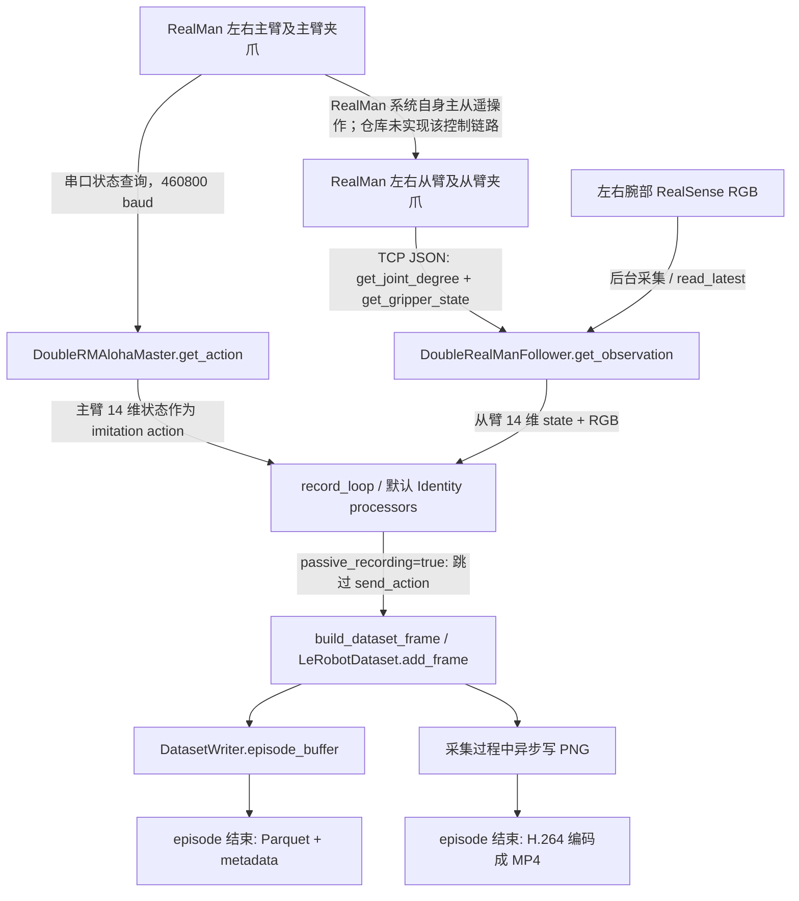

**RealMan 双臂采集与 LeRobot 集成：第一轮无硬件审计**

审计日期：2026-09-20。基准：`dev`，HEAD `7bad9dcd93ef0642d80088aed64c4339101b31dd`，以及开始审计时已有的未提交修改。没有升级依赖、修改生产采集逻辑、运行硬件诊断或恢复已删除文件。本轮新增离线审计脚本、报告和统计结果。

**结论先行**

1. 当前配置确实采用 RealMan 原有主从遥操作 + LeRobot 被动采集。主臂串口读数保存为 `action`；从臂 TCP JSON 状态保存为 `observation.state`。LeRobot 的采集循环不承担主从动作转发。
2. 仓库内三个 LeRobot 数据集的从臂左右夹爪都恒为 0；索引分别是 **6、13（从 0 开始）**，已用 `meta/info.json` 的 feature names 核实。主臂 action 在这三份数据中都不是恒零。
3. 真实软件管道可以保存非零夹爪值：mock JSON 回包 `actpos=321/654` → 从臂 adapter → 真实 `record_loop` → frame → episode buffer → Parquet，结果为 `0.321/0.654`；设缩放为 1 时原样保存 `321/654`。没有发现 Dataset 层把非零值改为 0。
4. **能够精确复现的首次填零位置**是 `RealManSocketClient.get_joint_positions()` 的 `has_gripper=False` 分支。初始提交配置确实关闭过夹爪。当前配置已打开，因此不能把这个历史原因套到所有 episode。
5. **当前启用夹爪的路径**读取 `get_gripper_state` 回包中的 `actpos`，除以 1000 后原样向下传递。缺字段会报错；接口返回零则接受。现在没有这些 episode 的原始回包和当时配置快照，不能声称已实测证明“硬件 API 首先返回了零”。定位边界已缩小到从臂反馈接口/有效性判断，而不是 Dataset 保存。
6. 发现已证实的接口检查缺口：`status=0, actpos=0` 也会返回有效数值 `0.0`，未校验在线、使能和错误状态。旧厂家工程另有 5 个 HDF5 episode，其从臂夹爪也全零；这个现象并非只出现在 LeRobot 格式中。

**一、先核对的 RealMan 官方资料与适用边界**

[官方 Teleoperation Kit 页面](https://realman-robotics.com/en/products/teleop-kit.html)描述主从同构遥操作、双臂和夹爪联动、以太网即插即用，以及 Aloha Local Teleop Kit。Aloha 列出的通信接口包括 RJ45/10-pin，使用总线舵机主臂。它支持“实时主从控制属于 RealMan 系统”的架构判断，但产品概述不能证明本机接线、控制器固件和夹爪适配情况。

[官方《入门指南：数据集采集机器人》](https://develop.realman-robotics.com/datatraining/guide/datacollectionrobot/)目前展示 RS-01：左右机械臂、头部和腕部相机、多种末端执行器，以及 API/JSON 等控制方式。这是整体系统参考，不能据此把本仓库的 RM65、两路腕部 RGB 直接解释成 RS-01 的配置，更不能推定本项目已实现官方系统宣传的传感器硬同步。[官方数据平台概述](https://develop.realman-robotics.com/datatraining/summarize/)也将采集机器人、采集软件和 LeRobot/HDF5 等数据格式分开描述。

[RealMan JSON 末端工具协议](https://develop.realman-robotics.com/robot4th/json/endTool/)明确把 `actpos` 定义为夹爪开口度，并列出 `enable/status/error/mode/current_force/temperature`；[C API 结构体](https://develop.realman-robotics.com/robot/apic/struct/gripperState/)同样有 `actpos`。这些是当前文档，不作为替换本机旧协议的依据。[官方旧 RM_API 仓库](https://github.com/RealManRobot/RM_API)也已核对；本机旧 SDK 的具体调用和结构体以下述本地源码为准。

**二、版本、来源和工作区状态**

| 项目 | 核实结果 |
|---|---|
| 本地包版本 | `pyproject.toml:28`、`uv.lock:2205`、已安装 editable 包均为 `0.5.2` |
| 实际加载路径 | `/home/nuaacmee/lerobot-main/src/lerobot/__init__.py`，不是另一个 site-packages 副本 |
| Python/主要运行依赖 | 本次使用既有 conda `lerobot`：Python 3.12.13、torch 2.10.0、datasets 4.8.4、pyarrow 23.0.1、numpy 2.2.6 |
| Dataset 版本 | 现存 LeRobot 元数据为 `codebase_version=v3.0`；这不是 Python 包版本 |
| 当前提交 | `7bad9dcd93ef0642d80088aed64c4339101b31dd`，2026-06-27 |
| 最早本地提交 | `0c764e5859cb096b32fd087a0d9c6bd7b551ea00`，2026-05-17；已经标记包版本 0.5.2 |
| Git 历史 | 共 6 个提交；不是 shallow clone；本地没有 tag，也没有上游祖先提交 |
| remote | origin 为 `JIA-Z423/lerobot-realman`；upstream 为 `huggingface/lerobot` |
| 源码组织 | 整套 LeRobot 源码直接纳入该独立历史仓库，实质是源码快照基础上的定制 fork；不是仅在外部引用 pip LeRobot 的小项目 |
| 依赖声明 | `pyproject.toml`、`uv.lock`、`requirements.in`（`-e .[all]`）、Ubuntu/macOS requirements 快照；未在本轮 sync/install |

**无法从当前历史确定精确的上游 tag/commit。** 不能把版本字符串 0.5.2 当成已证明来自官方 `v0.5.2` tag。作为邻近发布基线核对了官方 [v0.5.1 pyproject](https://github.com/huggingface/lerobot/blob/v0.5.1/pyproject.toml)、[record](https://github.com/huggingface/lerobot/blob/v0.5.1/src/lerobot/scripts/lerobot_record.py) 和 [Dataset](https://github.com/huggingface/lerobot/blob/v0.5.1/src/lerobot/datasets/lerobot_dataset.py)：其 Robot/Teleoperator、processor、DatasetWriter、流式/PNG 两条视频路径已经存在。因此当前工程并非缺少这些抽象的早期 LeRobot。官方 v0.5.1 不是本轮推定的确切来源。上游日期查询没有取得可用结果，也未修改本地 Git refs。

审计开始时已有：`client.py`、单臂配置/adapter、硬件 YAML、检查脚本和测试的未提交修改；多个新增夹爪诊断脚本、三个 PDF；仓库内 `rm_aloha_v1/` 大批文件处于删除状态。已保留这些改动。历史厂家代码通过 `git show HEAD:路径` 阅读；另只读检查了诊断脚本所引用的 `/home/nuaacmee/rm_aloha_v1/`。

当前未提交的夹爪修改包括可配置 `gripper_state_position_key` 和可选 Modbus feedback register 路径。**当前 YAML 仍选择 `socket_json + actpos`，没有启用 register 路径。** 这些现有修改不能表述成本轮已经解决了实际硬件问题。

**三、按当前配置画出的真实系统**



图中 RealMan 主从控制箭头来自用户说明和官方系统能力；本仓库能直接证明的是**采集不转发控制**，无法无硬件还原外部控制器之间实际协议。主臂到采集机使用串口、从臂到采集机使用 TCP，不能把这些读数连接等同于主从控制连接。

| 职责 | 当前负责代码 | 行为 |
|---|---|---|
| 主从遥操作 | RealMan 外部系统 | 被动采集模式不调用从臂动作转发；项目仍保留主动控制方法供其他模式使用 |
| 主臂状态 | [RMAlohaMaster](/home/nuaacmee/lerobot-main/src/lerobot/teleoperators/rm_aloha_master/rm_aloha_master.py:96)；[双主臂聚合](/home/nuaacmee/lerobot-main/src/lerobot/teleoperators/double_rm_aloha_master/double_rm_aloha_master.py:92) | 各自主臂串口查询、解码，线程池并行左右读数，加左右前缀 |
| 从臂状态 | [RealManSocketClient](/home/nuaacmee/lerobot-main/src/lerobot/common/realman/client.py:212)；[单臂 adapter](/home/nuaacmee/lerobot-main/src/lerobot/robots/realman_follower/realman_follower.py:125)；[双臂聚合](/home/nuaacmee/lerobot-main/src/lerobot/robots/double_realman_follower/double_realman_follower.py:98) | 每个臂先读关节、再读夹爪，左右臂并行 |
| 相机 | [RealSenseCamera._read_loop/read_latest](/home/nuaacmee/lerobot-main/src/lerobot/cameras/realsense/camera_realsense.py:461) | 后台读图，记录循环取最新 RGB；当前启用两路腕部，top 注释掉 |
| 记录入口 | [lerobot_record.record/record_loop](/home/nuaacmee/lerobot-main/src/lerobot/scripts/lerobot_record.py:325) | 默认 processor 透传，组成 observation/action/task，按 dataset.fps 采样 |
| 保存和编码 | [DatasetWriter](/home/nuaacmee/lerobot-main/src/lerobot/datasets/dataset_writer.py:157)、`image_writer.py`、`video_utils.py` | 数值先缓存，RGB 先写 PNG，episode 结束保存数值并编码视频 |

`action` 在当前被动模式中的准确含义：**采样时读到的主臂关节及主臂夹爪状态，作为模仿学习目标**。它不是从臂已经执行成功的命令回执，也不是从臂状态的副本。`observation.state` 是从臂反馈经过缩放得到的状态。两者默认 processor 均为 Identity。

“被动”的范围还有一个已发现的例外：公共模板 `initialize_gripper_route=true`，`robot.connect()` 内仍调用 `configure()`，向控制器发送 `set_gripper_route`；本地实际配置为 false。`passive_recording` 只拦住采集循环的 `send_action`，不自动拦住初始化配置写入。见 [connect/configure](/home/nuaacmee/lerobot-main/src/lerobot/robots/realman_follower/realman_follower.py:94) 和 [client.configure](/home/nuaacmee/lerobot-main/src/lerobot/common/realman/client.py:183)。本轮 mock 不调用硬件 connect，验证的是状态采样及保存路径。

**四、夹爪从 API 到最终文件的逐层追踪**

以下表中 `321/654` 是本轮注入的左右 mock API 值，**不是历史采集现场的回包**。

| 层 | 文件、类/函数、变量/key | 来源、mock 值、下一层取得方式 |
|---|---|---|
| 请求关节 | `client.py:243`，`RealManSocketClient._read_joint_values` | 发 `get_joint_degree`，读取 `response['joint']`，排除 gripper 名称，只处理六个关节；不从第七个 joint 值猜夹爪 |
| 请求夹爪 | `client.py:255`，`_read_gripper_value` | 发 `{'command':'get_gripper_state'}`；`_send_command_with_expected_key` 收消息直到出现配置字段 `actpos` |
| JSON 解码 | `client.py:329`，`_read_response` | socket 字节 → `json.loads(line)` → `response['actpos']=321/654` |
| 提取/缩放 | `client.py:120`，`BaseRealManClient._get_gripper_state_position` | `raw_value=payload.get('actpos')`；`float(raw_value)/1000` → `0.321/0.654`；`_last_gripper_value` 保存该结果 |
| 内部关节字典 | `client.py:212`，`get_joint_positions` | `joint_values['gripper']=gripper_value`；`has_gripper=false` 则不查询夹爪，直接 0 |
| 单臂观测 | `realman_follower.py:125`，`get_observation` | `obs['gripper.pos']=value`；相机是独立 image key |
| 双臂观测 | `double_realman_follower.py:98`，`get_observation` | `left_obs/right_obs` 加前缀 → `left_gripper.pos=0.321`、`right_gripper.pos=0.654` |
| 记录循环 | `lerobot_record.py:405` | `obs` → `robot_observation_processor(obs)` → `obs_processed`，默认不归一化、不补零 |
| feature 定义 | `lerobot_record.py:546`；`pipeline_features.py:68`；`utils/feature_utils.py:47` | 按 `robot.observation_features/action_features` 的顺序生成 names；左右各 joint_1…joint_6、gripper |
| frame | `utils/feature_utils.py:99`，`build_dataset_frame` | `np.array([values[name] for name in ft['names']], dtype=np.float32)`；`frame['observation.state'][6/13]=0.321/0.654`；缺 key 会报错，没有 `.get(...,0)` |
| 追加 | `lerobot_record.py:504`、`lerobot_dataset.py:352` | `frame={**observation_frame, **action_frame, 'task':...}`；`dataset.add_frame` 委托 writer |
| buffer | `dataset_writer.py:212`，`DatasetWriter.add_frame` | `dataset.writer.episode_buffer['observation.state'].append(frame[key])`；值不变 |
| episode 保存 | `dataset_writer.py:244`，`save_episode` | `np.stack` 把每帧向量组成 `[N,14]`；不对夹爪作特殊处理 |
| 最终 Parquet | `dataset_writer.py:371`，`_save_episode_data` | `datasets.Dataset.from_dict(ep_dict, features=hf_features)` → Arrow → `ParquetWriter.write_table`；读回索引 6/13 仍为非零 |

对应的主臂 action 链路是：`RMAlohaMaster.get_action()` 写查询字节 → `_read_encoded_frame()` → `_decode_master_state()`。六关节为各自 4 字节有符号小端值除以 10000；夹爪取 hex slice `[74:82]`（原始字节 `[37:41]`），除以 `gripper_scale=1000`。单臂 key 为 `gripper.pos`，双臂聚合为左右前缀；`act → act_processed_teleop → action_values → action_frame['action'][6/13]`。本轮特意使用不同主臂输入 `123/987`，保存成 `0.123/0.987`，验证 observation 没有被 action 覆盖。

完整维度顺序，两列一致：

```text
0..5   left_joint_1.pos ... left_joint_6.pos
6      left_gripper.pos
7..12  right_joint_1.pos ... right_joint_6.pos
13     right_gripper.pos
```

另外两个可选 backend 也检查到接口层，但当前 YAML 不使用它们：

| backend | 关节 API | 夹爪 API 与返回值 |
|---|---|---|
| `rm_aloha_sdk` | `Arm.Get_Joint_Degree()` → `(result, values)` | `RealManAlohaSDKClient._get_gripper_position` → `Arm.Get_Gripper_State()` → `(result, ctypes GripperState)` → `state.actpos/scale`；`rm_aloha_sdk.py:57,160` 定义结构体及 C DLL 调用 |
| `vendor_sdk` | `rm_get_current_arm_joint()` → `(0, payload)` | `RealManSDKClient._get_gripper_position` → `rm_get_gripper_state()` → 成功码和 payload → 配置字段/scale；没有把 joint 第七维当夹爪 |

HEAD 之前的 `vendor_sdk` 分支在方法缺失、actpos 缺失时曾返回 0；`7bad9dc` 改成报错。这个历史行为不能归因给当前使用的 socket backend。当前 `_last_gripper_value=0.0` 的初始化也**不是**正常查询失败时的回退：查询错误会抛出异常，不会返回缓存零。

**五、第一次出现零：确定性结论与证据边界**

**A. 已复现的软件填零。** [client.py:215](/home/nuaacmee/lerobot-main/src/lerobot/common/realman/client.py:215)：

```python
gripper_value = 0.0 if not self.config.has_gripper else self._read_gripper_value()
```

`0c764e5` 的双臂 YAML 两侧都 `has_gripper:false`，因此按该配置采集时，首次零就产生在这一行，甚至没有 follower gripper API 请求。`9680f94`（2026-05-24）才把两侧设为 true，并把主从夹爪统一除以 1000。提交标题同时明确记录从臂夹爪仍返回零。历史 episode 没保存配置和代码 SHA，不能只靠时间/文件夹名字认定每份数据走了哪条分支。

**B. 当前启用夹爪的路径。** `actpos` 非零能完整保存；缺字段会报错。若当前反馈确为零，最早可疑边界是 `_read_gripper_value` 接受的 API payload，而不是 frame、feature mapping 或 Parquet。原始 JSON 未保存，不能证明过去收到的是 `actpos=0`、错误回包、控制器占位值还是某个不同固件定义。

**C. 已复现的无效反馈被接受。** mock 回包 `{'enable':1,'status':0,'error':0,'actpos':0}` 会被当前 client 当作 `gripper=0.0` 返回。`_get_gripper_state_position` 只取位置字段；`_send_command_with_expected_key` 只按 key 匹配，不检验该回包的在线状态、错误码或 request/command 对应关系。因此“能收到 actpos 字段”不等于“读到了有效夹爪反馈”。这项缺口已经被 mock 证明，但没有证据说所有历史数据都由离线状态导致。

**D. LeRobot 之外的佐证。** `git show HEAD:rm_aloha_v1/utils/real_env.py` 的 `get_qpos` 同样发 `get_gripper_state`、取 `actpos`，再 append 到六关节数组。行 131 附近旧注释记录过 actpos 无数据、temperature 有变化；实际执行代码仍读 actpos。`record_episodes.py:53–55` 读取主臂 action 后调用无 action 参数的 `env.step()`，而不是 `step_rm(action)`，说明旧厂家采集程序也采用这种被动读数架构。另有 `step_rm` 控制函数存在，不等于它被采集调用。

`/home/nuaacmee/rm_aloha_v1/aloha_data/episode_0.hdf5` 至 `episode_4.hdf5` 均为 400×14、float32，`observations/qpos` 的夹爪两维全零。这里索引通过该厂家代码的 append/concatenate 顺序确认。旧 HDF5 并非原始回包，仍不能越过反馈读取层作硬件根因断言。

**六、已有 Dataset 的直接统计**

已检查仓库 `datasets/` 和默认 `~/.cache/huggingface/lerobot/`：9 个 metadata 根目录，其中 7 份有 Parquet、2 份空数据集，共 723 帧；另有上述 5 份 HDF5，共 2000 帧。没有在这些数据路径、当前仓库以及引用的厂家目录中找到可与 episode 对应的原始 JSON 状态日志。

三个仓库内数据集都是一个 episode，两列 dtype 为 float32，feature shape 为 `[14]`。下表统计按全部帧，std 为总体标准差；数字显示做了舍入。

| Dataset | FPS / 实际 shape | observation 夹爪 min/max/mean/std | action 左夹爪 min/max/mean/std | action 右夹爪 min/max/mean/std |
|---|---|---|---|---|
| `realman_double_arm_dataset` | 10 / `[80,14]` | 左右均 `0/0/0/0` | `42/800/389.275/234.963` | `26/660/303.613/188.373` |
| `realman_double_arm_dataset1` | 15 / `[120,14]` | 左右均 `0/0/0/0` | `0/0.639/0.186750/0.215023` | `0.076/0.780/0.306575/0.235775` |
| `realman_double_arm_dataset2` | 30 / `[234,14]` | 左右均 `0/0/0/0` | `0/0.842/0.407175/0.320342` | `0.044/0.850/0.453538/0.313464` |

这三份 observation **仅索引 6、13 恒零**；action 没有恒零维度。因此不能说“所有夹爪信号都没采到”，应准确说从臂反馈列异常。

缓存中 4 份非空数据集分别有 79、72、58、80 帧；observation 夹爪都零，action 左夹爪也恒零；右 action 有恒定 501 或最大 128257 的异常值。旧 HDF5 的右 action 也有最高 48897 的数值。它们说明还存在早期主臂数据质量问题，不能把这些数据只做统一除以 1000 后就当成有效演示。当前串口解析检查帧头和最小长度，没有实现完整 CRC/字段有效性检查；无法用本轮合成帧证实历史异常究竟来自对齐、协议版本还是其他输入。

全部 14 维的 feature names、shape、实际存储 dtype、min/max/mean/std、恒零维度和非有限值计数保存在 [results.json](results.json)；便于逐列查看的表在 [dimension_stats.csv](dimension_stats.csv)；旧数据统计在 [legacy_hdf5_stats.json](legacy_hdf5_stats.json)。

**七、离线 mock 的实现、结果和限制**

脚本：[audit_offline_pipeline.py](/home/nuaacmee/lerobot-main/examples/realman/audit_offline_pipeline.py)。只替换 socket 和 serial 字节传输对象；实际运行现有双臂 robot/teleoperator、默认 processors、feature 生成、record_loop、DatasetWriter、ParquetWriter。每个成功场景保存 3 帧，并在 frame、buffer、Parquet 回读三个边界断言值。主从夹爪用不同数值以检查两列没有串线。

| 场景 | 从臂原始输入 | 主臂原始输入 | 最终 observation[6,13] | 最终 action[6,13] | 结论 |
|---|---|---|---|---|---|
| 默认 scale=1000 | 321、654 | 123、987 | 0.321、0.654 | 0.123、0.987 | 非零完整通过 |
| scale=1 | 321、654 | 123、987 | 321、654 | 123、987 | Dataset 不会压零、截断到 0～1 |
| has_gripper=false | mock 可提供 321、654，但没有收到夹爪查询 | 123、987 | 0、0 | 0.123、0.987 | 重现最早填零分支 |
| actpos 缺失 | 缺字段 | — | 抛 RuntimeError | — | 不是静默补零 |
| status=0 且 actpos=0 | 离线回包 | — | client 返回 0.0 | — | 重现反馈有效性检查缺口 |

浮点回读中 `0.3210000098` 等是 float32 表示误差，不是数据损坏。所有 socket 请求都被检查，只出现 `get_joint_degree/get_gripper_state`；没有动作下发。mock 不包含真实相机、不验证串口协议与实际设备是否匹配、不验证固件反馈正确性，也不用于宣称 30 FPS 硬件性能达标。

本机没有找到可用 uv，本次复用已有 conda 环境，没有为审计安装依赖。复现命令（输出目录必须尚不存在）：

```bash
HF_DATASETS_CACHE=/tmp/realman-audit-hf-cache \
  /home/nuaacmee/anaconda3/envs/lerobot/bin/python \
  examples/realman/audit_offline_pipeline.py \
  --output /tmp/realman-audit-repeat \
  --datasets datasets /home/nuaacmee/.cache/huggingface/lerobot

PYTEST_DISABLE_PLUGIN_AUTOLOAD=1 \
HF_LEROBOT_HOME=/tmp/realman-audit-test-cache \
HF_DATASETS_CACHE=/tmp/realman-audit-hf-cache \
  /home/nuaacmee/anaconda3/envs/lerobot/bin/python -m pytest \
  tests/common/test_realman_client.py tests/test_control_robot.py -q --disable-warnings
```

结果：**23 passed，1 warning**；新增脚本 Ruff check 通过。首次测试启动受系统 ROS pytest 插件缺少 lark 干扰，禁用无关插件自动加载；随后把 Hugging Face 写缓存指向 `/tmp`，解决沙箱只读缓存限制后通过。无依赖升级。

**八、视频编码现状与 Git 历史核对**

当前明确采用：**采集时异步保存 PNG + 内存数值 buffer；episode 结束后保存 Parquet 并编码 H.264**。不是所有 raw data 在采集时都持续落盘，也不是跨 episode 自动后台编码。

实际调用链：

```text
RealSense 后台线程 → read_latest → frame[observation.images.*]
→ DatasetWriter.add_frame
→ _save_image → AsyncImageWriter（两路相机共 8 个线程）
→ PNG 临时文件
episode 结束 → save_episode → 等待图片线程 → 统计、写 Parquet
→ _encode_video_worker → encode_video_frames（PyAV/FFmpeg，H.264）
→ MP4 / 更新 episode metadata / 删除已编码的临时 PNG
```

`video_encoding_batch_size=1` 为默认；多相机编码默认通过进程池并行，但 `save_episode` 等待编码完成才继续。现有 `streaming_encoding=true` 的另一条路径是 `StreamingVideoEncoder.feed_frame` 将图片交给编码线程，episode 结束 flush。该路径在队列满时可能丢图并记录 warning；不能只看 loop 没报错就认定数值行和视频始终对应。

| 问题 | Git 和代码证据 |
|---|---|
| 当时 LeRobot 版本 | 最早可见提交已经是标记为 0.5.2 的本地源码快照，不能继续追到确定上游 commit |
| 原始实现有哪两种流程 | 邻近官方 v0.5.1 与当前源码都已有 streaming 与 PNG 后编码；并非新版才出现 |
| 用户是否切换过配置 | 最早提交的 YAML 已写 `streaming_encoding:false, vcodec:h264`，并注释此前实时 SVT-AV1 拖慢采集；可以证实选择结果和当时记录的动机 |
| 能否找到从 true 切 false 的提交 | 不能：这些设置从根提交就存在。`git blame` 指向 `^0c764e5`，不应虚构一个之后的优化 commit |
| 涉及文件 | 配置 `configs/hardware/realman_double_arm_hardware_config.yaml`；运行入口 `lerobot_record.py`；底层 `dataset_writer.py/image_writer.py/video_utils.py` |
| 后续是否修改过底层编码 | `git log` 及 `git diff 0c764e5 HEAD -- src/lerobot/datasets src/lerobot/cameras` 没有后续变更；无法判断根提交之前复制时是否有本地改动 |
| 新版是否更好 | 新版提供更细的 encoder 配置和后处理工具，但 PNG 后编码、异步写图、硬件编码在当前版本已存在；没有性能实测支持“升级就会更快” |

实际解码检查了仓库内 6 个 MP4：均为 H.264；第一份左右各 80 帧/8 秒，第二份各 120 帧/8 秒，第三份各 234 帧/7.8 秒，均与本次 Parquet 行数一致。详见 [video_stats.json](video_stats.json)。30 FPS 那份若实际按 8 秒采集，较理想 240 帧少 6 帧；不能在缺少原始 wall-clock 日志时认定准确丢帧原因或断言当次配置一定是 8 秒。

与视频质量相关的另一个直接代码事实：`DatasetWriter.add_frame` 的 timestamp 是 `frame_index/fps`；相机 `latest_timestamp` 只用于 `read_latest` 的过期检查，没有写入 dataset。左右相机可重复返回上一帧，左右臂及主从读数也并非同一硬件时刻采样。因此 metadata 的固定 FPS 不能证明真实多模态时间同步。新版 v0.6.1 writer 也仍采用这个合成 timestamp，升级本身不会消除该问题。

**九、夹爪型号/反馈通道的额外本地证据**

仓库已有 [夹爪手册.pdf](/home/nuaacmee/lerobot-main/夹爪手册.pdf) 明确是“睿尔曼机械臂 + 知行 CTAG2F120”，展示通过 RealMan 末端 Modbus 桥控制夹爪；它把位置 0 标为打开、1000 标为闭合。[产品使用操作手册.pdf](/home/nuaacmee/lerobot-main/产品使用操作手册.pdf) 的第 2.8/2.9 节（印刷页 22）给出 `0x0609–0x060A` 反馈位置、`0x060D–0x060E` 用户反馈位置，以及 high/low 组合方式。它们是仓库提供的手册，并非本轮核实了实际硬件铭牌和固件。

这些资料能解释为什么已有未提交代码正在探测 CTAG Modbus；但**不证明 RealMan 原生 `get_gripper_state.actpos` 会自动映射第三方夹爪的反馈**。也不能把“目标位置寄存器”当成“当前开口度”。当前新增 register 读取代码两次分开读 high/low，再除以同一个 `gripper_scale`；寄存器单位、开闭方向、一次一致性读取和与主臂标尺的匹配都还需要确认。

原生 RealMan 文档把 temperature 定义为温度。旧注释不能作为把 `gripper_state_position_key` 改成 temperature 的充分依据。首要缺失证据是：同一夹爪在已知开/合姿态时的完整原始反馈、对应控制器/夹爪版本及当时有效配置。

**十、与当前官方 LeRobot 的实际迁移价值**

本轮联网看到的最新稳定发布为 **v0.6.1**（发布页对应 commit 短 SHA `7e241bd`）；`main` 的 pyproject 标为 **0.6.2**，需区分开发分支与稳定发布。[官方发布页](https://github.com/huggingface/lerobot/releases/tag/v0.6.1)、[main pyproject](https://github.com/huggingface/lerobot/blob/main/pyproject.toml)。

| 方面 | 当前工程已经拥有 | 新版具体价值及本项目代价 |
|---|---|---|
| Robot abstraction | 已适配单/双 RealMan follower、单/双主臂 Teleoperator、processor | 不需要为获得这些抽象重写主从控制；迁移需处理类型导入等 API 变化 |
| Recording | 自定义 `passive_recording`，记录主臂 state 为 action | v0.6.1 将 policy 部署分离到 rollout，采集入口更聚焦；但官方 record 仍无此被动开关且直接调用 send_action，不能原样替换本项目入口 |
| Dataset | 已是 v3.0、Parquet+MP4、独立 writer | 新版 reader/writer 修复、语言/episode 处理能力可按需求吸收；没有证据需要仅为格式把现有数据全部重采/重转 |
| Video | PNG 后编码、streaming、线程/批编码、NVENC 等选项均已有 | 新版 RGB/depth encoder 分离、可配置编码参数、视频再编码工具有实际维护价值；两路 RGB 当前采集不急需 depth 路径 |
| Camera | RealSense 后台缓存读取 | 新版曝光/增益/白平衡设置有采集质量价值；仍要自己验证时间戳与重复帧 |
| IL/VLA 训练 | 已有 ACT、Diffusion、VLA 等 policy 目录及训练入口 | 新模型支持和依赖维护可在独立训练环境采用；优先解决从臂反馈真实性、action 单位、相机映射和时间对齐 |
| RL/Reward/World model | 不是夹爪反馈修复条件 | 新版相关能力只在具体训练目标明确时评估；当前不构成为采集链路升级的理由 |

上述新版变化依据 [v0.6.0 release](https://github.com/huggingface/lerobot/releases/tag/v0.6.0)、[v0.6.1 release](https://github.com/huggingface/lerobot/releases/tag/v0.6.1)、[v0.6.1 record 源码](https://github.com/huggingface/lerobot/blob/v0.6.1/src/lerobot/scripts/lerobot_record.py)、[writer 源码](https://github.com/huggingface/lerobot/blob/v0.6.1/src/lerobot/datasets/dataset_writer.py) 和[官方编码指南](https://huggingface.co/docs/lerobot/streaming_video_encoding)。这是源码/发布资料比较，没有在本机安装或性能测试新版。

明确迁移点：v0.6.1 的 `lerobot.types` 改为 `lerobot.lerobot_types`；v0.6.0 的 `dataset.vcodec` 改为 `dataset.rgb_encoder.vcodec`，依赖 extras 也有变化。当前本地源码已提前具备一些 0.6 系列发布提到的结构，必须按文件和接口逐项比较，不能按版本号想象差异。[导入变更说明](https://github.com/huggingface/lerobot/releases/tag/v0.6.1)、[编码配置变更说明](https://github.com/huggingface/lerobot/releases/tag/v0.6.0)。

合理的后续方向仍是：保留 RealMan 原有遥操作 → 小范围适配/验证读取与采集接口 → 保存可信的 Dataset → 按训练需要使用新环境。**本轮不建议把升级作为夹爪恒零的修复方案。**

**十一、下一步范围建议，尚未实施**

优先在现有版本添加可追溯的只读反馈诊断：记录完整 JSON/SDK 返回、时间、host/side、有效配置、代码 SHA、控制器版本和夹爪型号。在 `has_gripper=true` 下把“缺字段、离线/错误反馈”与“有效的闭合零值”区分开；正常闭合位置本来就可能为零，不能笼统禁止 0。

有硬件后，先在 RealMan 原有遥操作下采样开/中/合位置，核对 `actpos` 是否随实际姿态变化；若 CTAG 不接入该原生反馈通道，再根据匹配版本的手册验证实时反馈寄存器、单位及方向。已有部分检查脚本会下发夹爪位置或初始化 Modbus，不能仅按文件名把所有 probe 当作无副作用读数程序。

并行于接口定位，应把旧数据按量纲和有效性分组；全零从臂反馈不得用主臂 action 填充并冒充真实 observation。最后再做带真实采样时间、相机时间戳和重复帧统计的性能比较，决定是否需要更换编码参数或小范围迁移。
